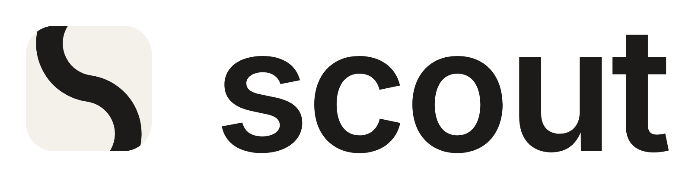

# scout — logo and app icon

Status: **proposal v2, 2026-10-25**. A mark for `scout`, the tool Craig uses
to research and plan third-party integrations. v1 (a cairn) was reviewed,
found wanting and withdrawn; the record of why is at the end, and the
exploration sheets for both are in `concepts/`.

## The mark

One stroke: an **S that is also a route**, built from two circles of the same
radius, leaned 8° forward, and cropped by the icon's frame.



The crop is the design. What the frame leaves is a path that enters at the
top edge and leaves at the bottom, so the route visibly continues beyond what
you can see — the territory the scout has gone into. The stroke divides the
plate into two fields, here and there, with the route the only thing
crossing between them. At 16px it is simply the letter S. The lean is the
only asymmetry, and it is the forward one.

It is the kind of object the brief's references are: Zed's Z filling and
cutting its square, OpenAI's blossom derived from six circles — one fused
abstract form, built from a rule, with internal structure (two counters, two
fields), not a picture of a scouting prop. Because the crop is the design,
**the mark is never used without its frame**: the tile is the mark.

## Geometry

Spelled once, in `build.py`, which writes every SVG here.

| | |
|---|---|
| Canvas | 1024 × 1024; plate 824 × 824 at (100, 100), corner radius 185 |
| Circles | radius 300 (centreline), centres (512, 212) and (512, 812) |
| Stroke | 175, butt caps; terminals at −50° (top circle) and 130° (bottom), both outside the plate |
| Lean | 8° clockwise about the centre, which puts both exits on the plate's flat edges |
| Visible stroke | 175/824 of the plate (21%); narrowest counter 125 (15%) — nothing thinner than 1/16 |

## Colour

| Role | Hex | Contrast |
|---|---|---|
| Pine (plate) | `#17402D` | paper on pine 10.3:1; pine on white 11.6:1 |
| Paper (route, light surfaces) | `#F4F1EA` | |
| Ink (mono mark, dark tile) | `#1C1B19` | paper on ink 15.3:1 |

One brand colour, chosen last and against the field: Zed's blue, Claude's
terracotta, Raycast's red, Linear's indigo, Arc's purple, Docker Scout's
mint, AWS and Firebase's orange and amber, Supabase's neon green are all
taken; a deep pine is held by none of them, and says terrain and outdoors
without a prop. Petrol was dropped for sitting in Docker Scout's hue family.
Everywhere but the app icon the mark is mono: ink on paper, paper on ink.

Alternates, as files, for one decision: `scout-icon-ink.svg` (mono plate)
and `scout-icon-navy.svg` — gnat's cream on navy (`#122B6E`, 11.6:1), to be
chosen only if scout is meant to read as a nat-family product.

## Files

| File | What it is |
|---|---|
| `build.py` | Writes every SVG below from the geometry above. Python 3; fonttools and Inter for the lockups and social preview. |
| `export.js` | Renders `png/` from the SVGs with Playwright's Chromium. |
| `scout-icon.svg` | App icon master: paper route on pine, 1024 canvas, 824 plate. |
| `scout-icon-ink.svg`, `scout-icon-navy.svg` | The alternates. |
| `scout-tile-dark.svg`, `scout-tile-light.svg` | The mark for READMEs and docs: the tile, full bleed, fixed colours (no `currentColor`, which is black inside an ``). |
| `scout-favicon.svg` | The tile, full bleed, pine. |
| `scout-layer.svg` | Icon Composer layer: the route alone, transparent, already at the system plate's scale (see macOS). |
| `scout-lockup-{dark,light}.svg` | Tile at cap height + "scout" as outlines. **Inter SemiBold is a placeholder face** — it is also Docker Scout's treatment; the typeface is an open decision. |
| `scout-social.svg` | 1280 × 640 GitHub social preview with one line saying what scout does. |
| `png/scout.iconset/` | `icon_16x16.png` … `icon_512x512@2x.png`, named as `iconutil` expects, every size from the same inset-plate master. |
| `png/scout-layer-1024.png` | The Icon Composer layer. |
| `png/favicon-{32,180,192,512}.png`, `png/favicon.ico` (16/32/48) | Web set: 180 is the opaque apple-touch-icon; 192/512 are maskable — the tile fills the canvas and the route crosses the whole plate. |
| `png/scout-tile-{dark,light}-256.png`, `png/scout-lockup-*.png`, `png/social-preview.png` | For READMEs and the repository settings. |
| `concepts/round-*.png` | Exploration, in order: 1–5 the cairn (withdrawn), 6–10 this mark. |

### README snippet

```html
<picture>
  <source media="(prefers-color-scheme: dark)" srcset="docs/design/scout-logo/png/scout-tile-dark-256.png">
  
</picture>
```

### macOS

Classic bundle, on a Mac:

```sh
iconutil -c icns docs/design/scout-logo/png/scout.iconset -o AppIcon.icns
```

macOS 26 (Icon Composer): new icon, one layer from `png/scout-layer-1024.png`,
fill `#17402D`. The layer is already rendered at 1024/824 — a layer's canvas
is the whole icon, so the plate's 824 maps onto 1024, the same scaling
`macos/Scripts/make-icon.sh` does for gnat — and the system draws plate,
rim and shadow and masks to its squircle. The route is one colour, so the
tinted and clear appearances need no second asset. **Not verified from
here**: this container has no Icon Composer or `iconutil`; the layer's
placement should be checked once on a Mac.

### Regenerating

```sh
python3 docs/design/scout-logo/build.py
node docs/design/scout-logo/export.js      # needs `playwright` resolvable (NODE_PATH or a local install)
cd docs/design/scout-logo/png && convert favicon-32.png \( favicon-32.png -resize 16x16 \) \( favicon-192.png -resize 48x48 \) favicon.ico
```

## Brief

The parameters the design was drawn to, from the research pass (three
agents: reference-brand visual language, scout metaphors and name
collisions, platform specs).

**Form.** One simple flat shape, uniform weight, built on a grid with
rounded corners; no texture, bevel, shadow or 3D. Asymmetry is fine. A
gradient is optional at most. Modern marks are modified only by flattening
or rounding, never by decorating. Each reference is one fused abstract
glyph — a letterform (Zed), a gesture (Claude), a derived knot (OpenAI) —
never an illustration of an object.

**Colour.** Two at most on any surface: one accent plus a neutral. Light
and dark artwork; a mono glyph for macOS 26's tinted mode.

**Avoid.** Compass (Docker Scout: needle on a mint disc), red square with
white chevrons (Laravel Scout), magnifier, radar, plug, puzzle piece,
braces, node graph, stacked stones (an existing Dashboard Icons mark, and
the wellness motif).

**Technical.** 1024 master; plate 824, corner radius ≈0.225 of the plate;
nothing thinner than 1/16 of the mark; favicon as SVG + 32 PNG + 180
apple-touch + 192/512 maskable; GitHub social preview 1280 × 640; README
logo via `<picture>` with a `prefers-color-scheme: dark` source.

## What v1 got wrong, for the record

v1 was a cairn: three stacked stones, "the marker a scout leaves for those
who follow". An adversarial review found a near-identical icon already in
Dashboard Icons, found the form reading as a figure, a stack or a traffic
cone at 16–32px, and found the amber-on-cream lockup at 1.9:1. The deeper
fault was a category error: a pictogram of an object where every reference
is an abstract fused form; three disconnected blobs with nothing happening
inside them, decorated with arbitrary tilts; and a story (stones → trail
marker → scout) that took three hops and lost at the first, since stacked
stones read as zen. The rounds that followed (`concepts/round-6` on) were
judged in mono first so colour could rescue nothing, and only forms built
from a rule were kept.
